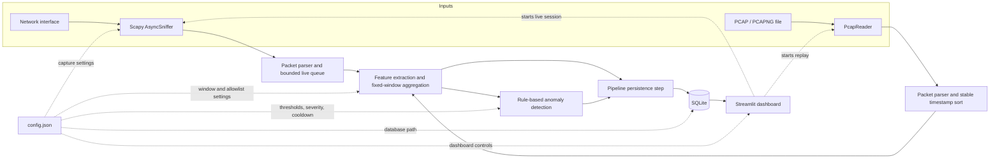

# Lattice

Lattice is a passive network traffic analysis and anomaly detection tool for offline packet captures and small-network monitoring. It extracts packet-header fields, summarizes traffic in fixed time windows, evaluates configurable detection rules, stores the results in SQLite, and presents them in a Streamlit dashboard.

Lattice does not block, modify, or inject traffic. Its events indicate traffic that crossed a configured threshold; they do not prove that an attack occurred.

## Capabilities

- Replay PCAP and PCAPNG files through a deterministic analysis pipeline.
- Capture live traffic from a selected interface through Scapy.
- Parse IPv4, IPv6, TCP, UDP, ICMP, ICMPv6, ARP, unknown IP protocols, and unsupported Ethernet types.
- Calculate packet and byte rates, protocol distributions, per-source traffic totals, TCP SYN counts, and distinct destination counts.
- Detect traffic-rate spikes, excessive TCP connection attempts, possible port scans or host sweeps, and traffic outside protocol or port allowlists.
- Persist runs, window statistics, selected source summaries, and anomaly events in SQLite.
- Explore stored traffic and events through a Streamlit dashboard.
- Generate deterministic synthetic captures and compare detected events with known scenarios.

Packet payloads are not retained by the analysis pipeline. Stored data still includes potentially sensitive metadata such as IP addresses, timestamps, event details, and input file paths.

## Architecture

Offline replay and live capture share the same parser, aggregation, detection, and persistence components. Offline records are sorted by packet timestamp before processing. Live records pass through a bounded queue and use the system clock to close idle windows.



The main implementation boundaries are:

- `lattice/capture.py`: offline capture reading, interface discovery, and live sniffing
- `lattice/parser.py`: Scapy packet normalization
- `lattice/features.py`: fixed-window aggregation and feature extraction
- `lattice/detector.py`: detection rules, severity, and alert cooldown
- `lattice/storage.py`: SQLite schema, transactions, and queries
- `lattice/pipeline.py`: shared offline/live processing pipeline
- `lattice/live.py`: live-session worker and lifecycle management
- `lattice/dashboard_data.py`: display-oriented data transformations
- `app.py`: Streamlit interface and controls

## Requirements

- Python 3.10 or newer
- Offline analysis: no administrator privileges required
- Live capture:
  - Windows: [Npcap](https://npcap.com/) and an Administrator terminal
  - Linux: root or suitable `CAP_NET_RAW`/`CAP_NET_ADMIN` capabilities
  - macOS: permission to access `/dev/bpf*`

Install the Python dependencies in a virtual environment:

```bash
python -m venv .venv
```

Activate it on Windows PowerShell:

```powershell
.\.venv\Scripts\Activate.ps1
python -m pip install -r requirements.txt
```

Or on Linux and macOS:

```bash
source .venv/bin/activate
python -m pip install -r requirements.txt
```

## Quick start

Process the included captures into a new database.

Windows PowerShell:

```powershell
python -m lattice --db lattice.db replay (Get-ChildItem .\samples\*.pcap).FullName
```

Linux and macOS:

```bash
python -m lattice --db lattice.db replay samples/*.pcap
```

Start the dashboard:

```bash
streamlit run app.py
```

Select a stored run in the sidebar. The dashboard reads persisted results and does not reprocess a capture when a historical run is selected.

## Offline capture analysis

Use the `replay` command with one or more files:

```bash
python -m lattice --config config.json --db lattice.db replay capture.pcap another-capture.pcapng
```

Global options such as `--config` and `--db` must appear before the `replay` subcommand. The `--force` option belongs after it:

```bash
python -m lattice --db lattice.db replay capture.pcap --force
```

Before replay, Lattice hashes the capture contents together with the window and detection configuration and an internal processing-version marker. A completed run with the same fingerprint is reused unless `--force` is supplied. Forced replay keeps existing completed results until the replacement completes successfully, then removes the superseded runs.

Records are sorted by packet timestamp using a stable sort, making results deterministic for a given capture, configuration, and implementation version. The full set of normalized packet records is held in memory during sorting, so large captures require proportionally more memory.

If a capture ends with a reader error after some packets were recovered, Lattice preserves the available results but marks the run `partial` and records the reader error. Partial runs are not reused by duplicate detection. Empty but valid captures complete with zero windows and zero events.

The dashboard can also process a server-local capture path from **Input & controls**. Its sample selector lists captures in `samples/`.

## Live capture

Only capture traffic on interfaces and networks you are authorized to monitor.

Inspect available interfaces and the environment readiness message:

```bash
python -m lattice interfaces
```

Start a live session:

```bash
python -m lattice --db lattice.db live --interface "Ethernet" --filter "tcp or udp" --duration 300
```

Omit `--duration` to run until Ctrl+C. Interface names are platform-specific; copy the name reported by the `interfaces` command.

Live capture places parsed records into a bounded queue. If the queue is full, new records are dropped and counted rather than blocking the sniffer. Stopping a session signals the worker, stops the sniffer, drains queued records, flushes the last populated window, and closes the run record.

The live-capture lifecycle is tested with a threaded fake sniffer, including queue overflow and failure handling. Real-interface capture depends on the host OS, capture driver, permissions, and interface configuration and should be validated in the intended deployment environment.

## Detection rules

Every rule fires only when the observed value is strictly greater than its threshold.

| Rule | Default condition | Interpretation |
|---|---|---|
| Traffic spike | Packet rate above 1,000 packets/s, byte rate above 1,000,000 bytes/s, or either rate above 4 times its recent moving average | A window-wide increase in traffic volume. Packet-rate and byte-rate conditions produce separate events. |
| Excessive connection attempts | More than 100 TCP SYN-without-ACK packets from one source in a window | Repeated TCP connection attempts; not a count of established connections. Retransmitted SYN packets count again. |
| Possible port scan or host sweep | More than 20 distinct destination ports or 20 distinct destination hosts reached by SYN-without-ACK packets from one source | Possible TCP SYN scanning. Port and host conditions produce separate events. |
| Unexpected protocol or port | More than 10 packets in a window fall outside the configured allowlists | Traffic that does not match the local protocol or service-port policy. |

Traffic-spike baselines retain the most recent six windows and require at least three. Near-zero baselines are ignored. A long skipped gap resets the baseline; shorter gaps are represented by empty windows and remain part of the history.

Severity is derived from `observed / threshold`:

- `INFO`: below the configured warning ratio
- `WARNING`: at or above the warning ratio
- `HIGH`: at or above the high ratio

With the default ratios, `WARNING` begins at 2 times the threshold and `HIGH` at 5 times the threshold.

Cooldown is tracked by rule, source, and metric using event time. An equal- or lower-severity repeat is suppressed for 30 seconds by default; a higher-severity event is admitted immediately.

## Time windows and statistics

Windows are half-open intervals, `[start, end)`, aligned to multiples of `window.seconds` on the packet-timestamp axis. Rates use the complete configured window length:

```text
packets_per_second = packet_count / window_seconds
bytes_per_second   = byte_count / window_seconds
```

Consequently, the final partially populated window of a capture can show a lower rate. Gaps of up to `window.max_gap_windows` are stored as empty windows. Larger gaps are skipped and cause the moving baseline to reset.

Per-source SYN, destination-port, and destination-host measurements include only TCP SYN packets without ACK. This prevents normal server replies from being treated as scan attempts. Packets that arrive older than the currently open live window are folded into that window and counted as late.

## Dashboard

Run:

```bash
streamlit run app.py
```

The dashboard provides:

- **Overview**: run status, processing totals, analyzed window time, average and peak rates, skipped packets, and cooldown suppressions
- **Traffic analytics**: packet and byte rate timelines, protocol distribution, and exact stored source totals ranked by packets, bytes, or TCP SYN attempts
- **Anomaly events**: rule, severity, and time filters plus a focused event inspector showing the explanation, observed value, configured threshold, sampled destinations, and the adjacent traffic windows
- **Input & controls**: offline replay, live-session start/stop, and the active configuration

Failed and partial runs are called out explicitly. Processing a capture from the dashboard refreshes the run list and selects the resulting run automatically.

Set dashboard-specific path overrides before starting Streamlit:

Windows PowerShell:

```powershell
$env:LATTICE_DB = "C:\captures\lattice.db"
$env:LATTICE_CONFIG = "C:\captures\config.json"
streamlit run app.py
```

Linux and macOS:

```bash
LATTICE_DB=/data/lattice.db LATTICE_CONFIG=/data/config.json streamlit run app.py
```

These environment variables are read by `app.py`. For the CLI, use the global `--db` and `--config` options instead.

The dashboard has no built-in user authentication. Run it in a trusted environment, particularly because its controls can read server-local capture paths and start live monitoring.

Event queries display at most 2,000 matching rows at once and report the complete filtered count. Narrow the rule, severity, or time filters to inspect later events. Configuration is cached by the Streamlit process; restart Streamlit after editing `config.json`.

## Configuration

`config.json` is loaded by default. Missing keys use built-in defaults, while unknown keys, invalid types, and out-of-range values cause startup to fail with the offending key named.

| Key | Default | Purpose |
|---|---:|---|
| `database.path` | `lattice.db` | SQLite database path |
| `capture.interface` | `null` | Default live interface |
| `capture.bpf_filter` | `null` | Default BPF capture filter |
| `capture.queue_size` | `20000` | Maximum queued live records |
| `window.seconds` | `5` | Fixed window duration |
| `window.max_gap_windows` | `12` | Maximum empty windows inserted across a gap |
| `window.top_talkers` | `10` | Source summaries persisted per window |
| `window.max_sources_per_window` | `5000` | In-memory source tracking limit |
| `detection.cooldown_seconds` | `30` | Repeat-event suppression period |
| `detection.severity.warning_ratio` | `2.0` | Warning boundary for observed/threshold |
| `detection.severity.high_ratio` | `5.0` | High-severity boundary |
| `detection.traffic_spike.enabled` | `true` | Enable traffic-spike detection |
| `detection.traffic_spike.pps_threshold` | `1000` | Absolute packet-rate limit; `null` disables it |
| `detection.traffic_spike.bps_threshold` | `1000000` | Absolute byte-rate limit; `null` disables it |
| `detection.traffic_spike.moving_average_multiplier` | `4.0` | Recent-average multiplier; `null` disables it |
| `detection.traffic_spike.baseline_windows` | `6` | Maximum rate-history length |
| `detection.traffic_spike.min_baseline_windows` | `3` | Required history before relative comparison |
| `detection.traffic_spike.min_baseline_pps` | `1.0` | Minimum packet-rate baseline |
| `detection.traffic_spike.min_baseline_bps` | `100.0` | Minimum byte-rate baseline |
| `detection.connection_attempts.enabled` | `true` | Enable excessive-SYN detection |
| `detection.connection_attempts.max_syn_per_source` | `100` | Per-source SYN threshold |
| `detection.port_scan.enabled` | `true` | Enable scan detection |
| `detection.port_scan.max_distinct_ports` | `20` | Per-source destination-port threshold |
| `detection.port_scan.max_distinct_hosts` | `20` | Per-source destination-host threshold; `null` disables it |
| `detection.unexpected_traffic.enabled` | `true` | Enable allowlist detection |
| `detection.unexpected_traffic.max_packets` | `10` | Window-wide unexpected-packet threshold |
| `detection.unexpected_traffic.allowed_protocols` | TCP, UDP, ICMP, ICMPv6, ARP | Permitted protocol names |
| `detection.unexpected_traffic.allowed_ports` | 22, 53, 80, 123, 443 | Permitted TCP/UDP ports or inclusive ranges such as `"8000-8100"` |

A TCP or UDP packet conforms to the port allowlist when either endpoint port is allowed. This accommodates replies whose service port is the source port, but it also means a sender can evade the check by deliberately using an allowed source port.

Each rule can be disabled independently. Tune thresholds and allowlists for the traffic being monitored; the defaults are examples rather than universal security policy.

## Database

Lattice creates four tables:

- `runs`: one row per replay or live session
- `traffic_stats`: one row per finalized time window
- `source_stats`: selected top sources associated with a window
- `events`: admitted anomaly events

Each window, its source summaries, its events, and the updated run totals are written in one transaction. Foreign keys use cascading deletion, and file-backed databases use SQLite write-ahead logging so dashboard readers do not block the writer.

Databases carry an application identifier and schema version. Lattice refuses an existing foreign SQLite database and a Lattice database created with an unsupported schema version rather than attempting an unsafe implicit migration.

Create the schema explicitly:

```bash
python -m lattice --db lattice.db init-db
```

Reset a dedicated Lattice database:

```bash
python -m lattice --db lattice.db reset-db --yes
```

Reset refuses to proceed without `--yes` and refuses non-Lattice SQLite files. Resetting deletes all stored Lattice runs and results.

## Project structure

```text
.
|-- app.py                     Streamlit dashboard
|-- config.json                Default runtime configuration
|-- lattice/
|   |-- capture.py             PCAP input and live capture
|   |-- cli.py                 Command-line interface
|   |-- config.py              Configuration models and validation
|   |-- dashboard_data.py      Dashboard data transformations
|   |-- detector.py            Detection rules
|   |-- features.py            Window aggregation and features
|   |-- live.py                Live-monitor worker
|   |-- models.py              Shared records and result models
|   |-- parser.py              Packet normalization
|   `-- storage.py             SQLite persistence
|-- scripts/
|   |-- evaluate.py            Scenario evaluation and report generation
|   `-- traffic_gen.py         Seeded synthetic PCAP generation
|-- samples/                   Generated example PCAPs
|-- evaluation/                Checked-in evaluation results
`-- tests/                     Unit and integration tests
```

## Testing and verification

Run the complete test suite:

```bash
python -m pytest
```

Tests cover configuration validation, packet parsing, PCAP and PCAPNG reading, aggregation, all detection rules, cooldown behavior, SQLite transactions and concurrent reads, duplicate replay handling, CLI commands, dashboard data, synthetic evaluation, and live-session lifecycle using a fake sniffer.

The headless dashboard tests require Streamlit. The host capture-backend check is skipped by default because it starts Scapy's real sniffer on a deliberately invalid interface. Run it only in an authorized environment:

```powershell
$env:LATTICE_TEST_REAL_CAPTURE = "1"
python -m pytest tests/test_live.py -k real_sniffer
```

```bash
LATTICE_TEST_REAL_CAPTURE=1 python -m pytest tests/test_live.py -k real_sniffer
```

Generate deterministic sample captures without sending network traffic:

```bash
python -m scripts.traffic_gen --out samples
```

Run the synthetic scenario evaluation and refresh `evaluation/results.json` and `evaluation/RESULTS.md`:

```bash
python -m scripts.evaluate
```

Skip the optional throughput workload:

```bash
python -m scripts.evaluate --bench-packets 0
```

The generated scenarios verify expected behavior under controlled inputs. They do not establish detection accuracy on production traffic.

## Known limitations

- Detection is threshold-based and limited to four traffic patterns. It can miss slow, distributed, or below-threshold activity and flag legitimate bursts.
- Scan detection observes TCP SYN-without-ACK traffic only. UDP, ICMP, FIN, NULL, Xmas, and application-layer scans are not detected.
- The system does not reconstruct TCP sessions, deduplicate SYN retransmissions, reassemble IP fragments, inspect TLS content, or analyze payloads.
- Fixed windows can split a burst or scan across boundaries. A partly populated final window reports a rate based on the complete configured duration.
- Moving-average spike detection adapts to sustained high traffic, which can stop the relative condition from firing even while load remains high. Absolute limits remain independent.
- Source tracking is bounded. Packets from sources beyond `window.max_sources_per_window` remain in window totals but do not contribute to per-source SYN or scan rules.
- Only `window.top_talkers` source summaries are stored per window, so dashboard run-wide source rankings are based on those stored summaries rather than every observed source.
- Unexpected-traffic detection is only as accurate as its allowlists and can be bypassed with an allowed source port.
- PCAP replay loads normalized records into memory for timestamp sorting.
- Live capture can drop packets when the processing queue is full; drops are counted but cannot be analyzed later.
- Real-interface live capture has not been validated by the automated test suite.
- Lattice is a monitoring tool, not an intrusion prevention system, and does not take automated response actions.

## Contributing

Keep changes focused and include tests for behavior changes. Before submitting a change, run:

```bash
python -m pytest
```

Changes to configuration, commands, detection semantics, or stored data should include corresponding documentation updates.

## License

This repository does not currently include a license file. Until a license is added, no open-source license grant should be assumed.
