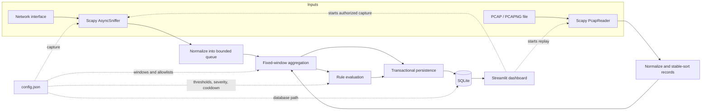

# Lattice

Lattice is a local, passive network traffic analysis tool. It replays PCAP and PCAPNG files or observes an authorized network interface, reduces packet headers into fixed-window statistics, applies explainable detection rules, and stores the results in SQLite for investigation in a Streamlit dashboard.

Lattice does not block, modify, or inject traffic. A detection event means that a configured threshold was crossed; it is evidence to investigate, not proof of an attack.

## What it provides

- Deterministic replay of PCAP and PCAPNG captures
- Live capture through Scapy with a bounded processing queue
- Header-level parsing for IPv4, IPv6, TCP, UDP, ICMP, ICMPv6, ARP, unknown IP protocols, and unsupported Ethernet types
- Fixed-window packet, byte, protocol, source, SYN, and destination-diversity statistics
- Four configurable detection categories with severity levels and cooldowns
- Transactional SQLite storage for runs, windows, retained source summaries, and detection events
- A Streamlit dashboard for findings, traffic analysis, event investigation, capture processing, run comparison, and exports
- Seeded synthetic traffic and a reproducible evaluation workflow

The analysis pipeline does not retain packet payloads. Persisted metadata can still be sensitive: it includes addresses, timestamps, event evidence, and, for CLI replay, the input path.

## Contents

- [Architecture](#architecture)
- [Install](#install)
- [Quick start](#quick-start)
- [Analyze capture files](#analyze-capture-files)
- [Capture live traffic](#capture-live-traffic)
- [Use the dashboard](#use-the-dashboard)
- [Detection and configuration](#detection-and-configuration)
- [Testing and evaluation](#testing-and-evaluation)
- [Limitations and safe operation](#limitations-and-safe-operation)
- [Project layout](#project-layout)

Detailed behavior is documented in the [technical reference](docs/technical-reference.md). For setup and runtime failures, see the [troubleshooting guide](docs/troubleshooting.md).

## Architecture

Offline replay and live capture use the same normalization, aggregation, detection, and persistence pipeline. The input adapters differ: offline records are held in memory and stably sorted by timestamp, while live records pass through a bounded queue and use the system clock to close idle windows.



The major implementation boundaries are:

| Component | Responsibility |
|---|---|
| `lattice/capture.py` | PCAP/PCAPNG reading, interface discovery, and live sniffing |
| `lattice/parser.py` | Scapy packet normalization into header-only records |
| `lattice/features.py` | Fixed-window feature extraction and bounded source tracking |
| `lattice/detector.py` | Detection rules, severity, moving baseline, and cooldown |
| `lattice/storage.py` | SQLite ownership checks, schema, transactions, and queries |
| `lattice/pipeline.py` | Shared offline/live processing and run lifecycle |
| `lattice/live.py` | Live worker, stop handling, queue draining, and final flush |
| `lattice/dashboard_analysis.py` | Findings, uploads, comparisons, and exports |
| `lattice/dashboard_data.py` | Display-oriented data transformations |
| `app.py` | Streamlit views and controls |

## Install

### Prerequisites

- Python 3.10 or newer
- Offline replay requires no capture driver or elevated privileges
- Live capture additionally requires:
  - Windows: [Npcap](https://npcap.com/) and an Administrator terminal
  - Linux: root or appropriate packet-capture capabilities, commonly `CAP_NET_RAW` and `CAP_NET_ADMIN`
  - macOS: permission to access the `/dev/bpf*` devices

Create an isolated environment and install the dependency ranges:

```bash
python -m venv .venv
```

Windows PowerShell:

```powershell
.\.venv\Scripts\Activate.ps1
python -m pip install -r requirements.txt
```

Linux or macOS:

```bash
source .venv/bin/activate
python -m pip install -r requirements.txt
```

## Quick start

Process all included sample captures into `lattice.db`.

Windows PowerShell:

```powershell
python -m lattice --db lattice.db replay (Get-ChildItem .\samples\*.pcap).FullName
```

Linux or macOS:

```bash
python -m lattice --db lattice.db replay samples/*.pcap
```

Then start the dashboard:

```bash
streamlit run app.py
```

Choose a run from the sidebar. Selecting a historical run reads its stored results; it does not replay the capture.

## Analyze capture files

### Command line

Pass one or more files to `replay`:

```bash
python -m lattice --config config.json --db lattice.db replay capture.pcap another-capture.pcapng
```

Global options must precede the subcommand. The replay-specific `--force` option comes after the input files:

```bash
python -m lattice --db lattice.db replay capture.pcap --force
```

Lattice fingerprints the capture contents, processing settings, and an internal processing-version marker. An existing completed result with the same fingerprint is reused unless `--force` is supplied. A forced replay leaves the known-good run in place until its replacement completes successfully.

Records are stably sorted by packet timestamp. Equal timestamps retain file order, so replay is deterministic for a capture, configuration, and Lattice version. Sorting requires all normalized records to be held in memory; use smaller captures when memory is constrained.

Before parsing, Lattice checks classic-PCAP record framing or PCAPNG block framing without loading packet data. A file cut off mid-record, such as an interrupted copy or a capture still being written, is therefore reported even when Scapy can recover its earlier records. A file whose header claims to be a capture but is invalid fails before a run is created.

Packets that Lattice cannot normalize are counted as malformed and skipped. A truncation, framing problem, or reader error after recoverable records produces a `partial` run with the reason in its note; partial runs are not reused by duplicate detection. Empty, valid captures complete with zero windows and events.

### Dashboard

Open **Captures and history** to upload a `.pcap` or `.pcapng`, process a repository sample, or enter a path that is local to the Streamlit host. Uploads:

- are limited to 100 MiB;
- must have a supported extension and recognized PCAP/PCAPNG header;
- are parsed through the same replay pipeline as the CLI;
- use a temporary file that is removed after processing; and
- store the supplied filename, not the temporary server path.

The header check rejects obvious non-capture input; successful analysis still depends on Scapy being able to parse the file. Completed or reused results are selected automatically.

## Capture live traffic

Only capture interfaces and networks you are authorized to monitor.

List Scapy-visible interfaces and the platform readiness message:

```bash
python -m lattice interfaces
```

Start a bounded session:

```bash
python -m lattice --db lattice.db live --interface "Ethernet" --filter "tcp or udp" --duration 300
```

Omit `--duration` to continue until Ctrl+C. Interface names are platform-specific; copy the exact name printed by `interfaces`. BPF-filter availability depends on the host capture backend.

Live records enter a bounded queue. When it is full, new records are dropped and counted instead of blocking the sniffer. A normal stop signals the worker, stops the sniffer, drains queued records, flushes the last populated window, and records the run as `stopped`.

The dashboard exposes the same live lifecycle under **Captures and history**, with an explicit authorization checkbox. Automated tests use a fake threaded sniffer; real-interface behavior still depends on the target OS, driver, privileges, and interface configuration.

## Use the dashboard

Start Streamlit from the repository root:

```bash
streamlit run app.py
```

The dashboard listens on `127.0.0.1` only (set in `.streamlit/config.toml`), so it is reachable from the same machine at <http://localhost:8501> but not from other hosts. It has no authentication; if you deliberately need LAN access, pass `--server.address 0.0.0.0` and do so only on a trusted network.

The four views are:

| View | Purpose |
|---|---|
| **Overview** | Run state, processing totals, stored-window coverage, ranked findings, traffic timeline, protocol shares, leading retained sources, and significant events |
| **Traffic analytics** | Packet/byte rate timelines, protocol totals, retained source summaries, and per-window destination diversity |
| **Anomaly events** | Search and rule/severity/time filters, event selection, observed value and threshold, rule explanation, destination evidence, investigation guidance, and adjacent windows |
| **Captures and history** | Upload/replay, live controls, run comparison, JSON/CSV ZIP exports, and the active configuration |

Key findings are deterministic summaries of persisted measurements. Detection findings group repeated matches of the same rule and metric; descriptive findings may highlight a material traffic peak, dominant protocol, or concentrated retained source. Neither category establishes malicious intent.

Event timestamps and exported timestamps are UTC. Run comparison uses stored-window coverage for average rates and events per minute, and protocol shares instead of raw protocol totals. Partial, failed, or active results are labelled as provisional.

Interactive event results are capped at 2,000 matching rows. Narrow the filters to inspect a smaller result set. JSON and CSV ZIP exports intentionally query all events for the selected run and include run metadata, findings, windows, events, and retained source summaries.

Override dashboard paths with environment variables before starting Streamlit.

Windows PowerShell:

```powershell
$env:LATTICE_DB = "C:\captures\lattice.db"
$env:LATTICE_CONFIG = "C:\captures\config.json"
streamlit run app.py
```

Linux or macOS:

```bash
LATTICE_DB=/data/lattice.db LATTICE_CONFIG=/data/config.json streamlit run app.py
```

The dashboard caches the loaded configuration for the Streamlit process. Restart it after editing the configuration file.

## Detection and configuration

All rule comparisons are strict: equality does not fire a rule.

| Detection category | Default trigger | What it indicates |
|---|---|---|
| Traffic spike | More than 1,000 packets/s, more than 1,000,000 bytes/s, or more than 4 times the eligible recent moving average | A window-wide increase in traffic volume; packet and byte conditions are separate metrics |
| Excessive TCP SYN activity | More than 100 TCP SYN-without-ACK packets from one source in one window | Repeated connection attempts, including retransmitted SYNs; not completed connections |
| Possible port scan or host sweep | More than 20 distinct destination ports or hosts reached by SYN-without-ACK packets from one source | Destination diversity consistent with SYN probing; not proof of intent or success |
| Unexpected protocol or port | More than 10 packets in one window fall outside the configured protocol or TCP/UDP port allowlists | Traffic outside the local allowlist policy |

Severity is based on `observed / threshold`. By default, values below 2 times the threshold are `INFO`, values from 2 up to 5 times are `WARNING`, and values at or above 5 times are `HIGH`. Cooldown is normally keyed by rule, source, and metric; the window-wide unexpected-traffic rule ignores its informational contributor field. An equal- or lower-severity repeat is suppressed for 30 seconds of event time, while escalation is admitted immediately.

`config.json` is loaded by default. Use another file with `--config` or `LATTICE_CONFIG`. Missing keys receive built-in defaults, while unknown keys, invalid types, invalid ranges, and inconsistent values fail with a named error.

The shipped file is the complete configuration example. See the [configuration reference](docs/technical-reference.md#configuration-reference) for every key, default, validation rule, aggregation detail, and detector limitation. Thresholds and allowlists must be tuned to the monitored environment; the shipped values are examples, not a universal security policy.

## Storage

Lattice stores results in four SQLite tables: `runs`, `traffic_stats`, `source_stats`, and `events`. A finalized window, its retained sources, its events, and updated run totals are written in one transaction. Foreign keys cascade when a run is removed, and file-backed databases use write-ahead logging for concurrent dashboard reads.

Create the schema explicitly:

```bash
python -m lattice --db lattice.db init-db
```

Reset a dedicated Lattice database:

```bash
python -m lattice --db lattice.db reset-db --yes
```

Reset deletes every stored run and refuses to touch an existing SQLite database that is not marked as a Lattice database. See [persistence and run lifecycle](docs/technical-reference.md#persistence-and-run-lifecycle) for schema ownership and run-state details.

## Testing and evaluation

Run the complete suite:

```bash
python -m pytest
```

The suite covers configuration validation, parser behavior, PCAP and PCAPNG input (including truncated and invalid files), window boundaries and an independent aggregation recomputation, all four detection categories, severity and cooldown, SQLite transactions and concurrent reads, duplicate replay, CLI commands, export consistency with SQLite, dashboard data and workflows, synthetic evaluation, and live lifecycle behavior with a fake sniffer.

The real capture-backend check is skipped by default because it starts Scapy's sniffer against a deliberately invalid interface. Run it only in an authorized environment:

Windows PowerShell:

```powershell
$env:LATTICE_TEST_REAL_CAPTURE = "1"
python -m pytest tests/test_live.py -k real_sniffer
```

Linux or macOS:

```bash
LATTICE_TEST_REAL_CAPTURE=1 python -m pytest tests/test_live.py -k real_sniffer
```

Generate the seeded sample files without sending network traffic:

```bash
python -m scripts.traffic_gen --out samples
```

Run the controlled scenario evaluation and regenerate `evaluation/results.json` and `evaluation/RESULTS.md`:

```bash
python -m scripts.evaluate
```

To skip the optional single-machine throughput workload:

```bash
python -m scripts.evaluate --bench-packets 0
```

The checked-in [evaluation results](evaluation/RESULTS.md) record the seed, configuration, inputs, rule matches, and machine-dependent timing from one run. They demonstrate behavior on controlled synthetic inputs; they are not estimates of real-world detection accuracy, false-positive rate, or deployment throughput.

## Limitations and safe operation

- Detection is threshold-based and limited to four traffic patterns. Slow, distributed, or below-threshold behavior can be missed, and legitimate bursts can produce events.
- Scan-related statistics use TCP SYN without ACK only. UDP, ICMP, FIN, NULL, Xmas, and application-layer scans are not detected. Lattice does not infer session state, connection success, malicious intent, or unique attempts.
- Fixed windows can split activity at a boundary. Rates always divide by the full configured duration, including the final partially populated window; short bursts are averaged across that duration.
- The moving traffic baseline adapts to sustained load, so the relative spike condition can stop firing while an independently configured absolute limit remains active.
- Source tracking and persistence are bounded. Packets beyond the per-window source cap remain in overall totals but cannot contribute to per-source rules; only the configured number of top source rows is stored for later analysis.
- Port allowlisting accepts a TCP or UDP packet when either endpoint is allowed. This accommodates replies, but a deliberately chosen allowed source port can evade the port-policy check.
- Replay stably sorts all normalized records in memory. Live capture can drop records when its queue is full; the run counters report those drops.
- The shipped port allowlist is deliberately small. Common LAN services can produce repeated unexpected-traffic events until the allowlist is tuned to the monitored environment.
- A killed process can leave a `running` row. The dashboard infers interruption from database-wide inactivity, so another active writer can delay that label.
- Payload inspection, stream reassembly, IP-fragment reassembly, automated response, and prevention are outside the project scope.
- The dashboard has no authentication. It binds to loopback by default; do not expose it to untrusted users, because it can read server-local capture paths and start live capture.
- SQLite files, captures, and exports contain sensitive network metadata. Protect them according to the environment in which they were collected.
- Automated tests do not validate capture on a real interface. Follow the [manual validation procedure](docs/troubleshooting.md#validate-live-capture-manually) on each target platform.

## Project layout

```text
.
|-- app.py                     Streamlit dashboard
|-- .streamlit/config.toml     Dashboard theme
|-- config.json                Shipped runtime configuration
|-- docs/
|   |-- technical-reference.md Processing, rules, configuration, and persistence
|   `-- troubleshooting.md     Installation and runtime diagnostics
|-- lattice/                   Core Python package
|-- scripts/
|   |-- evaluate.py            Controlled evaluation and report generation
|   `-- traffic_gen.py         Seeded synthetic capture generation
|-- samples/                   Generated deterministic PCAP fixtures
|-- evaluation/                Checked-in reproducible evaluation artifacts
`-- tests/                     Unit, integration, CLI, and dashboard tests
```

## Contributing

See [CONTRIBUTING.md](CONTRIBUTING.md) for the development workflow and review expectations. Behavior changes should include tests and synchronized documentation.

## License

This repository does not currently include a license file. Source visibility alone does not grant permission to copy, modify, or redistribute the project; no open-source license grant should be assumed until the maintainers add one.
