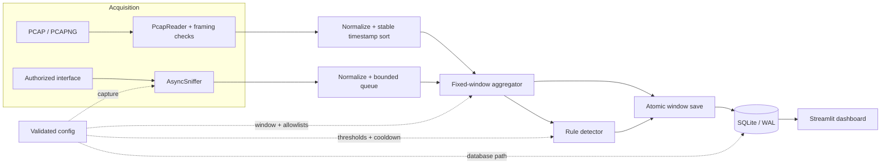
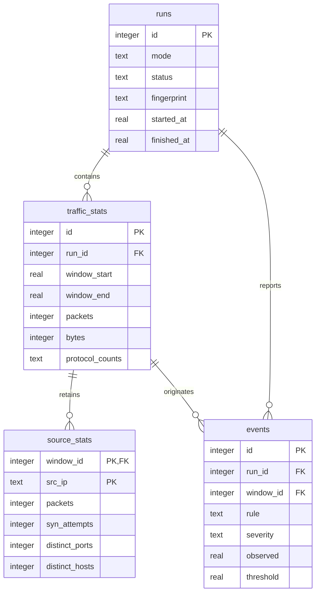

# Lattice technical reference

This document describes the processing semantics implemented by the current Lattice codebase. The [README](../README.md) contains installation and task-oriented usage.

For commands and dashboard workflows, see the [user guide](user-guide.md).

## System architecture

Offline replay and live capture are input adapters for one shared processing
pipeline. They differ in ordering and lifecycle: offline replay normalizes all
records and stably sorts them by packet timestamp, while live capture delivers
records through a bounded queue and advances idle windows using the system
clock.



| Module | Responsibility |
|---|---|
| `lattice.models` | Scapy-independent packet, window, event, ingest, and run data models |
| `lattice.capture` | Capture-file framing checks and reading, interface discovery, and asynchronous live sniffing |
| `lattice.parser` | Header-only normalization from Scapy packets to `PacketRecord` |
| `lattice.features` | Epoch-aligned fixed windows, protocol totals, source statistics, allowlist classification, and resource bounds |
| `lattice.detector` | Traffic-spike, SYN-activity, scan/sweep, and unexpected-traffic rules plus severity and cooldown |
| `lattice.pipeline` | Shared record-to-window-to-event orchestration, duplicate fingerprints, and offline run lifecycle |
| `lattice.live` | Live worker lifecycle, clock advancement, queue draining, and finalization |
| `lattice.storage` | SQLite ownership checks, schema, transactions, WAL setup, and result queries |
| `lattice.dashboard_analysis` | Evidence-backed findings, safe uploads, normalized comparison metrics, and exports |
| `lattice.dashboard_data` | UTC and unit-aware display transformations |
| `app.py` | Streamlit navigation, views, controls, and user-visible state |

The `Pipeline` owns one `Aggregator` and one stateful `Detector`. Each finalized
window is evaluated once and then passed with its events to `Storage.save_window`.
The dashboard opens short-lived read-only connections; a live worker owns a
separate writable connection in its thread.

## Packet acquisition and normalization

### Offline input

`lattice.capture.iter_pcap_records` uses Scapy's `PcapReader`, which accepts classic PCAP and PCAPNG files. Before parsing, Lattice walks classic-PCAP record framing or PCAPNG block framing without loading packet data. This catches incomplete records and blocks that Scapy can otherwise accept silently. The reader then yields packets in file order; `load_pcap_records` converts them to `PacketRecord` values and applies a stable ascending timestamp sort.

Lattice distinguishes three outcomes:

- a file with an invalid capture header or that cannot be opened raises `CaptureError` before a run row is created;
- a packet that reaches the parser but has invalid required metadata increments the malformed count and is skipped; and
- broken framing, truncation, or a reader exception after recoverable packets records a read error, preserves processed data, and produces a `partial` run.

Framing checks establish that declared records or blocks are complete; they do not make every contained packet semantically valid. For example, an IPv4 packet declaring TCP but lacking a complete TCP header remains an IP packet with unavailable ports and flags. Structurally invalid required fields, including zero-length frames, are counted as malformed.

### Live input

`LiveCapture` wraps Scapy's `AsyncSniffer` with `store=False`. Its callback normalizes each packet and attempts a non-blocking write to a fixed-size queue. Malformed packets and queue-overflow drops are counted separately. `LiveMonitor` gives the worker its own SQLite connection, periodically advances the aggregator with the system clock, and exposes startup or worker failures to the caller.

Stopping is idempotent. It stops and joins the sniffer, drains records already in the queue, flushes the last populated window, and finalizes the run. Automated tests use a fake sniffer and do not establish that a host's driver, permissions, or interface selection is correct.

### Normalized fields

Each accepted packet becomes a header-only `PacketRecord` containing:

- Unix timestamp and packet length (the PCAP wire length when available,
  otherwise the serialized packet length);
- normalized protocol name;
- source and destination IP addresses, when present;
- source and destination transport ports, when present;
- TCP flags, for parsed TCP headers; and
- IP version, for IPv4 or IPv6.

Protocols are labelled `TCP`, `UDP`, `ICMP`, `ICMPv6`, `ARP`,
`IP_PROTO_<number>`, `ETHERTYPE_0x<type>`, or `OTHER` as appropriate. IPv6
extension headers are traversed before the final next-header value is classified.
Ethernet addresses, payload bytes, TCP sequence state, and application data are
not retained by the pipeline.

## Window aggregation

Windows are epoch-aligned, half-open intervals `[start, end)`. For a configured length `W`, the window index is `floor(timestamp / W)`. A packet exactly on a boundary belongs to the new window.

Each finalized window contains:

- packet and captured-byte totals;
- packet and byte rates, both divided by `W`;
- packet counts by normalized protocol;
- per-source packet and byte totals;
- per-source TCP SYN-without-ACK counts;
- per-source distinct destination ports and hosts for those SYN packets;
- unexpected-packet totals and bounded evidence; and
- late, untracked-source, and post-gap markers.

The final window is stored only when it contains packets. Its rates still divide by the complete configured duration, so a short tail can appear lower than the instantaneous arrival rate.

Offline input is timestamp-sorted before aggregation. In live mode, a packet older than the currently open window is folded into that open window and increments `late_packets`; finalized windows are never reopened.

For gaps no larger than `window.max_gap_windows`, empty windows are materialized with zero counts and rates. A larger gap is skipped, the next populated window is marked `after_gap`, and the detector clears its moving traffic baseline.

### Bounded state and retained source rows

The aggregator tracks at most `window.max_sources_per_window` source addresses. A packet from an additional source still contributes to window, byte, protocol, and unexpected-traffic totals, but not to per-source SYN or scan statistics. It increments `untracked_packets`.

At persistence time, only `window.top_talkers` source rows are kept for each window, ranked by packet count. Consequently:

- detector rules see every source tracked during the live window, not merely the persisted top talkers;
- dashboard source totals are sums of retained rows and can be lower than run totals; and
- dashboard destination diversity is the maximum stored per-window value, not a distinct count across the entire run.

Unexpected-reason keys and unexpected-source contributors also have internal bounds (`64` reasons and `256` sources per window); excess reasons are grouped as `other`. Destination-host sets are capped at 65,536 entries per tracked source and window.

## Detection rules

Rules evaluate finalized `WindowStats`. Every threshold comparison is strict (`>`), so an observed value equal to its threshold does not produce an event.

### Traffic spike

Packet rate and byte rate are evaluated independently. For each metric, a candidate event is produced if at least one enabled condition holds:

```text
observed_rate > absolute_threshold
observed_rate > moving_average_multiplier * recent_average
```

The recent average contains at most `baseline_windows` previous windows and is eligible only after `min_baseline_windows` entries. The relative packet baseline must be at least `min_baseline_pps`; the relative byte baseline must be at least `min_baseline_bps`. This prevents any traffic after a near-zero baseline from looking infinitely large. Empty windows within a short gap participate in history; a long gap resets it.

If absolute and relative limits are both crossed, the stored threshold is the smaller crossed limit. This is the condition exceeded by the largest ratio and therefore the one used for severity and explanation.

### Excessive TCP SYN activity

For each tracked source:

```text
SYN packets with ACK clear > max_syn_per_source
```

The value counts packets, not unique flows, successful handshakes, or established connections. Retransmitted or duplicate SYNs count again. SYN-ACK, ACK-only, UDP, and other packets do not contribute.

### Possible port scan or host sweep

For each tracked source, Lattice separately tests:

```text
distinct destination ports in SYN-without-ACK packets > max_distinct_ports
distinct destination hosts in SYN-without-ACK packets > max_distinct_hosts
```

The host condition can be disabled with `null`. Counts reset at each window boundary. Repeated packets to an already counted destination do not increase distinctness. Both conditions use the `possible_port_scan` rule identifier but store different metrics.

These measurements are consistent with probing; they do not establish intent or whether any connection succeeded.

### Unexpected protocol or port

A packet is unexpected when its normalized protocol is absent from `allowed_protocols`. A TCP or UDP packet with a parsed destination port is also unexpected when neither endpoint port is in `allowed_ports`. Checking both endpoints allows ordinary replies whose service port is the source port, but a sender that deliberately uses an allowed source port can evade this check.

The rule is window-wide:

```text
unexpected packets > max_packets
```

It stores a bounded breakdown of reasons and attributes the event source to the largest recorded contributor when one is available. Non-TCP/UDP packets are governed only by the protocol allowlist. TCP/UDP records without a parsed destination port do not undergo a port check.

## Severity and cooldown

For an admitted candidate, severity uses `ratio = observed / threshold`:

| Condition | Severity |
|---|---|
| `ratio < warning_ratio` | `INFO` |
| `warning_ratio <= ratio < high_ratio` | `WARNING` |
| `ratio >= high_ratio` | `HIGH` |

Cooldown keys are normally `(rule, source, metric)`. Within `cooldown_seconds` of the previous admitted event time, a candidate with equal or lower severity is suppressed; a higher severity is admitted immediately. Event time is the window end, which keeps replay deterministic. Suppressed candidates increment the run's `suppressed_events` total but are not stored as event rows.

The unexpected-traffic condition is window-wide. Its event `src_ip` identifies the largest recorded contributor for investigation, but cooldown deliberately omits that value and uses `(rule, None, metric)`. A changing top contributor therefore does not create duplicate alerts for the same continuing window-level condition.

## Configuration reference

`load_config()` reads the repository `config.json` by default. A missing explicit path is an error; if the built-in default path itself is absent, dataclass defaults are used. JSON objects are merged section by section over defaults. Unknown keys, wrong types, non-finite numbers, invalid ranges, and inconsistent severity or baseline settings raise `ConfigError`.

| Key | Type | Default | Validation and effect |
|---|---|---:|---|
| `database.path` | string | `lattice.db` | Non-empty; CLI `--db` and dashboard `LATTICE_DB` can override it |
| `capture.interface` | string or `null` | `null` | Uses the configured interface, or Scapy's default when null |
| `capture.bpf_filter` | string or `null` | `null` | Passed to the live capture backend; syntax support is platform-dependent |
| `capture.queue_size` | integer | `20000` | At least 1; bounds queued normalized live records |
| `window.seconds` | number | `5` | Finite and greater than 0; fixes window width and rate denominator |
| `window.max_gap_windows` | integer | `12` | Non-negative; larger gaps are skipped instead of materialized as empty windows |
| `window.top_talkers` | integer | `10` | At least 1; number of source rows persisted per window |
| `window.max_sources_per_window` | integer | `5000` | At least 1; bounds in-memory source-specific aggregation and detection |
| `detection.cooldown_seconds` | number | `30` | Non-negative finite event-time interval for suppressing equal/lower-severity repeats |
| `detection.severity.warning_ratio` | number | `2.0` | Finite and greater than 1 |
| `detection.severity.high_ratio` | number | `5.0` | Finite and greater than `warning_ratio` |
| `detection.traffic_spike.enabled` | boolean | `true` | Enables packet-rate and byte-rate spike evaluation |
| `detection.traffic_spike.pps_threshold` | number or `null` | `1000` | Positive finite absolute packet-rate threshold; null disables this condition |
| `detection.traffic_spike.bps_threshold` | number or `null` | `1000000` | Positive finite absolute byte-rate threshold; null disables this condition |
| `detection.traffic_spike.moving_average_multiplier` | number or `null` | `4.0` | Greater than 1; null disables the relative condition |
| `detection.traffic_spike.baseline_windows` | integer | `6` | At least 1; maximum number of preceding rates retained |
| `detection.traffic_spike.min_baseline_windows` | integer | `3` | From 1 through `baseline_windows`; history required before relative comparison |
| `detection.traffic_spike.min_baseline_pps` | number | `1.0` | Positive finite floor for an eligible packet-rate baseline |
| `detection.traffic_spike.min_baseline_bps` | number | `100.0` | Positive finite floor for an eligible byte-rate baseline |
| `detection.connection_attempts.enabled` | boolean | `true` | Enables per-source SYN-without-ACK counting |
| `detection.connection_attempts.max_syn_per_source` | integer | `100` | At least 1; fires only when a source's window count is strictly greater |
| `detection.port_scan.enabled` | boolean | `true` | Enables distinct destination-port and host checks for SYN probes |
| `detection.port_scan.max_distinct_ports` | integer | `20` | At least 1; strict per-source, per-window threshold |
| `detection.port_scan.max_distinct_hosts` | integer or `null` | `20` | At least 1; null disables host-sweep evaluation |
| `detection.unexpected_traffic.enabled` | boolean | `true` | Enables window-wide allowlist evaluation |
| `detection.unexpected_traffic.max_packets` | integer | `10` | At least 1; strict window-wide threshold |
| `detection.unexpected_traffic.allowed_protocols` | list of strings | TCP, UDP, ICMP, ICMPv6, ARP | Entries must be non-empty; comparison is case-insensitive; an empty list allows none |
| `detection.unexpected_traffic.allowed_ports` | list of port entries | 22, 53, 80, 123, 443 | Integers, numeric strings, or inclusive ranges such as `"8000-8100"`; endpoints must be 0 through 65535 |

An enabled traffic-spike rule must retain at least one absolute or relative threshold. Each detection category can otherwise be disabled independently.

## Persistence and run lifecycle

Lattice marks its database with SQLite application ID `LATT` and schema version `1`. It refuses a non-empty foreign SQLite database and a Lattice database with an unsupported schema version. File-backed writable connections enable foreign keys and write-ahead logging. Each thread creates its own `Storage` connection.

Offline duplicate lookup reuses only a `completed` run with the same fingerprint.
Partial, failed, running, and stopped runs are never treated as a completed replay.
With `--force`, completed predecessors remain available until the replacement has
completed successfully; they are then removed through cascading foreign keys.

The tables are:

| Table | Stored data |
|---|---|
| `runs` | Mode, source label, fingerprint, lifecycle status, timestamps, aggregate counters, and note |
| `traffic_stats` | One row per stored window, including rates, protocol JSON, and data-quality counters |
| `source_stats` | Retained top source rows associated with a window |
| `events` | Admitted detector events with rule, metric, evidence, threshold, and originating window |



Foreign keys use cascading deletion, and foreign-key enforcement is enabled on
every connection. The `(run_id, window_start)` pair is unique for traffic
windows. Indexes support fingerprint lookup, run/time window queries, run/time
event queries, and event filtering by rule or severity. SQL filter values use
bound parameters; dynamic source-sort columns come from a fixed whitelist.

`save_window` inserts the window, retained sources, events, and current run totals in one SQLite transaction. A failed window transaction is logged and increments `storage_errors`; packet processing continues. The run becomes `partial` if the offline reader reported an error or any window failed to store.

Run totals describe successfully processed packets even when a storage failure
prevents a corresponding window from being committed. For a partial run, the
sum of stored windows can therefore be lower than the run-level processed total.

User-visible statuses have these meanings:

| Status | Meaning |
|---|---|
| `running` | A run row exists and the worker has not finalized it; an old untouched row is shown as interrupted by the dashboard |
| `completed` | Offline replay finished without a recorded reader or storage error |
| `partial` | Offline replay retained usable results but encountered a reader or storage error |
| `stopped` | Live capture ended normally, including a user-requested stop or duration limit |
| `failed` | Processing after run creation or live capture ended with an exception or interruption; the run can contain data stored before failure |

Run start and finish timestamps use the system clock. Traffic windows and event times use packet timestamps. They describe different concepts and need not span the same duration.

## Dashboard analytics and exports

The [user guide](user-guide.md#streamlit-dashboard) describes the controls and
end-user workflows. This section records calculation and retention semantics.

Dashboard averages and comparison rates divide stored window totals by stored-window coverage. Coverage is the sum of every stored window duration, including materialized empty windows. It is not processing time and can differ from wall-clock capture time.

Protocol shares use counts represented in stored traffic windows. Source rankings sum only retained `source_stats` rows. The overview obtains a bounded event list for interactive display; explicit exports retrieve the complete event set.

Findings also surface incomplete run states, untracked-source packets, and late
live packets as data-quality observations. They do not reconstruct source
statistics that were never tracked or persisted.

The JSON export contains nested run metadata, findings, windows, events, and source summaries. The CSV export is a ZIP with separate CSV files so different row shapes remain explicit. Protocol counts remain available inside each exported traffic-window row. Timestamps are ISO 8601 UTC values and byte rates remain bytes per second. Source labels are reduced to filenames so exports do not disclose local directory paths.

Explicit export retrieves all event rows rather than applying the interactive
2,000-row cap. Source export is still bounded: it is derived from the retained
per-window top talkers and returns at most 1,000 aggregated source rows.

The general dashboard analysis loader reads at most 10,000 events. Overview
findings warn when this limit is reached. Run comparison currently uses this
bounded event list when calculating stored events per minute, so that one
comparison metric can be understated for runs with more than 10,000 events;
explicit event export remains complete.

Uploaded files receive a suffix and magic-byte check before Scapy parsing. This is a format guard, not a content-security guarantee. Keep the unauthenticated dashboard in a trusted environment.

## Testing and evaluation semantics

Run all automated tests from the repository root:

```bash
python -m pytest
```

The suite separates pure processing tests from Streamlit behavior. Parser,
window, detector, storage, pipeline, and export calculations use ordinary
pytest assertions. Dashboard workflows use Streamlit's in-process `AppTest` to
exercise navigation, filters, run selection, capture processing, comparison,
exports, and error states without a browser. Live lifecycle tests use fake
threaded sniffers so they do not observe real traffic.

The environment-gated real-backend test is skipped unless
`LATTICE_TEST_REAL_CAPTURE=1` is set. It verifies clean failure for a deliberately
invalid interface; it is not a substitute for an authorized real-interface
validation on the deployment host.

The controlled evaluation is generated with:

```bash
python -m scripts.evaluate
```

`scripts.traffic_gen` uses a fixed seed to create eight deterministic capture
scenarios: ordinary traffic, a rate spike, elevated SYN activity, a port scan,
a host sweep, an unexpected IP protocol, an unexpected TCP port, and combined
unexpected traffic. Files are written to disk and replayed through the normal
parser, aggregator, detector, and SQLite pipeline; no packets are transmitted.

Each injected incident records an expected rule, interval, and optional source.
It is counted as matched when at least one stored event has the same rule,
matches the source when specified, and has a window overlapping the injection
interval. One incident can produce several events, and the port-scan scenario
intentionally expects both scan and unexpected-port detections. An event that
matches no injected incident is reported as unmatched by this scenario oracle.
That term is not a general false-positive-rate estimate.

The optional throughput workload writes seeded background traffic, then times
capture reading, Scapy normalization, aggregation, detection, and SQLite
persistence. Capture generation is outside the timed `RunSummary`. Packet and
event counts are deterministic for a seed and configuration; elapsed time and
throughput depend on Python, hardware, storage, and current system load. Treat
the checked-in [evaluation results](../evaluation/RESULTS.md) as a reproducible
controlled observation, not a performance guarantee or real-world accuracy
claim.
